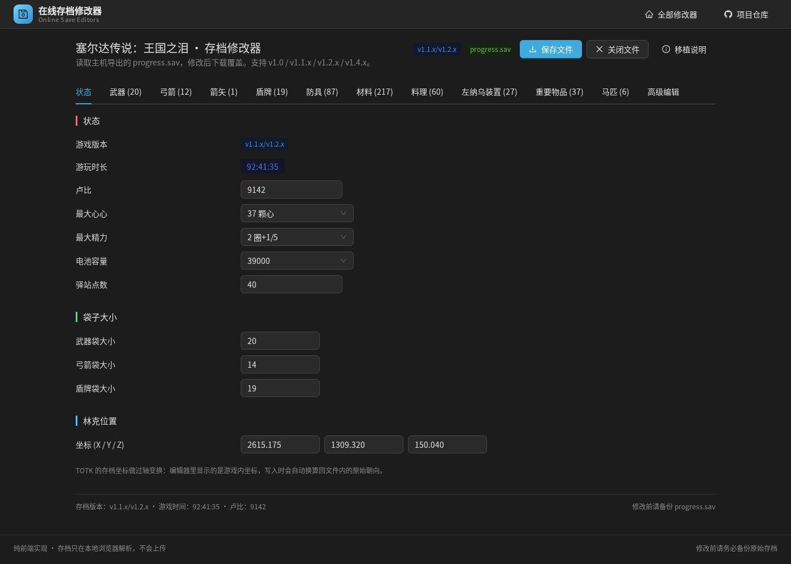
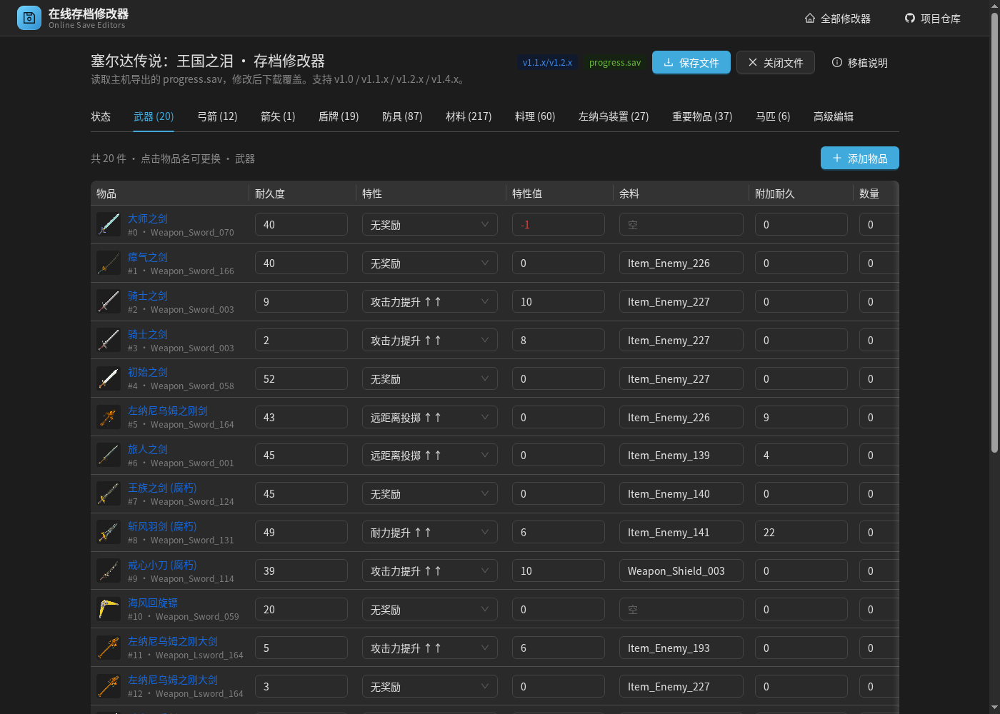

[简体中文](README.md)

# Online Save Editors

A pure front-end **collection of online game save editors**. Open it in a browser and edit console save files directly — nothing to install, and the save never leaves your machine. One game is included for now; the same framework is ready for more.

- Repository: https://github.com/matcha-cult/game-editors
- Included: *The Legend of Zelda: Breath of the Wild* (Wii U / Switch, v1.0 – v1.8/v1.9)
- Routing: **hash mode**, URLs look like `/#/zelda-botw`, so static hosting needs no rewrite rules

## Tech stack

| Layer | Choice |
| --- | --- |
| Build | Vite 8 |
| View | React 19 + TypeScript |
| Routing | React Router 7 (`HashRouter`) |
| UI kit | Ant Design 6.6 (dark theme, Chinese locale) |
| Save I/O | Hand-written `DataView` binary layer, no third-party dependencies |

## Routes

| URL | Page |
| --- | --- |
| `/#/` | Editor collection home page (game cards) |
| `/#/zelda-botw` | Breath of the Wild save editor |
| `/#/zelda-totk` | Tears of the Kingdom save editor |
| any other `/#/...` | 404 page with a button back home |

Why hash routing: it works on GitHub Pages, object storage and any sub-path without server-side rewrite rules, and it also works when `index.html` is opened directly from disk.

## Included editors

| Game | Platforms | Main features |
| --- | --- | --- |
| The Legend of Zelda: Breath of the Wild | Wii U / Switch | rupees, hearts, stamina, items and modifiers, horses, coordinates, map pins, bulk Korok/enemy unlocks, compendium reset, raw hash-table advanced editor |
| The Legend of Zelda: Tears of the Kingdom | Switch | rupees, max hearts, battery size, nine pouch categories (durability / modifiers / fused material / dyes / food effects), horses, coordinates, full hash-table advanced editor |

> Adding a game: implement a page under `src/games/<id>/`, then add one entry to the `GAMES` array in `src/games/registry.tsx`; the home card and the route are generated automatically.

## Screenshots

| Collection home | Breath of the Wild editor |
| --- | --- |
|  |  |

| Tears of the Kingdom (status) | Tears of the Kingdom (weapons) |
| --- | --- |
|  |  |

## Getting started

```bash
npm install          # install dependencies
npm run dev          # dev server, default http://localhost:5173
npm run build        # production build into dist/
npm run preview      # preview the production build
```

Deployment: serve the `dist/` folder from any static host (GitHub Pages, Nginx, …). `vite.config.ts` sets `base: './'`, so it also works under a sub-path, and hash routing needs no extra configuration.

## Usage

1. Export the save from your console: Switch (Atmosphere CFW) under `sd:/atmosphere/titles/01007EF00011E000/save/`, Wii U under `mlc01/usr/save/00050000/101C9400/user/<user id>/`. The folders `0/`–`5/` are the six slots, each containing one `game_data.sav`.
2. Open the game from the home page and drop a **single** save file onto the drop zone (not the whole `save_0` folder).
3. Click **Save file** (top right) and the browser downloads the modified save; overwrite the one on your console.
4. Save once in-game and quit normally, so the console cache does not overwrite your changes.

> Always back up the original save before editing.

## Supported versions (Breath of the Wild)

The version table covers v1.0 / v1.1 / v1.2 / v1.3 / v1.3.1 / Kiosk / v1.3.3 / v1.3.4 / v1.4 / v1.5 / v1.5\* / v1.6 / v1.6\* / v1.6\*\* / v1.6\*\*\* / v1.8·v1.9, and also accepts modded saves whose file size is between 896,976 and 1,500,000 bytes.

## Project layout

```
game-editors/
├── index.html                  # Vite entry
├── package.json
├── vite.config.ts
├── docs/                       # screenshots
├── public/
│   └── assets/                 # icon sheets, sample save, hash table (45,052 entries)
└── src/
    ├── main.tsx                # entry: ConfigProvider + Chinese locale + HashRouter
    ├── App.tsx                 # route table (home / each game / 404)
    ├── theme.ts                # Ant Design theme tokens
    ├── index.css               # site and page styles
    ├── layout/
    │   └── AppLayout.tsx       # site shell: top nav + footer
    ├── pages/
    │   ├── HomePage.tsx        # collection home page
    │   └── NotFoundPage.tsx    # 404
    ├── games/
    │   ├── registry.tsx        # game list: route, title, platforms, thumbnail, page component
    │   ├── zelda-totk/         # Tears of the Kingdom editor
    │   │   ├── ZeldaTotkPage.tsx  # game page (tabs + toolbar)
    │   │   ├── core/           # struct engine (hash table / variables / arrays), save I/O, murmur3, labels
    │   │   ├── data/           # field definitions, item limits, armor info, modifiers, zh locale
    │   │   ├── state/          # React state for load / edit / download
    │   │   └── components/     # status, pouch, horses, advanced editor, icons
    │   └── zelda-botw/
    │       ├── ZeldaBotwPage.tsx  # game page (toolbar + tabs)
    │       ├── core/           # binary I/O, version table, save logic, advanced editor, icons, score
    │       ├── data/           # item names (1,012) and location coordinates (1,171)
    │       ├── state/          # React state for load / edit / download
    │       └── components/     # drop zone, status page, item page, horses, advanced editor, icon
```

## Data notes

- Item names, modifiers, dyes, horse types, Korok and enemy hashes were mechanically converted from the existing editor data; no values were retyped by hand.
- Icons come from 23 sheets of 16 columns × 64 px, cropped via `background-position`; armor uses the dyed entry in the same row.
- The hash table (`public/assets/zelda-botw.hashes.csv`) is loaded on demand when the advanced editor tab is opened, so it stays out of the initial bundle.
- Tears of the Kingdom field definitions, item limits, armor info, modifiers and zh locale were likewise mechanically converted; name hashing uses murmur3 (x86 32-bit) and was verified against known key values.
- TotK item icons are loaded on demand from `public/assets/totk/item_icons/<category>/<item id>.png`; dyed armor icons live under `armors/dye/`.

## Tears of the Kingdom port scope

Included: save detection (v1.0 / v1.1.x-1.2.x / v1.4.x, plus modded saves), player status, nine pouch categories (durability / modifiers / fused material / dyes / food effects), horses, coordinates, and the raw hash-table advanced editor.

Not included in this pass (the structure is ready for them): one-click completion unlocks (shrines / towers / Koroks / caves / bosses), bulk map pins with the coordinate database, EXP/level calculator, autobuild (schema) editor, save JSON import/export, paraglider fabric replacement.

## Disclaimer

- This tool is for personal save editing only. Back up your save first; any save corruption or lost progress caused by using this tool is the user's own responsibility.
- Do not use this tool for commercial purposes or in online/competitive scenarios.
