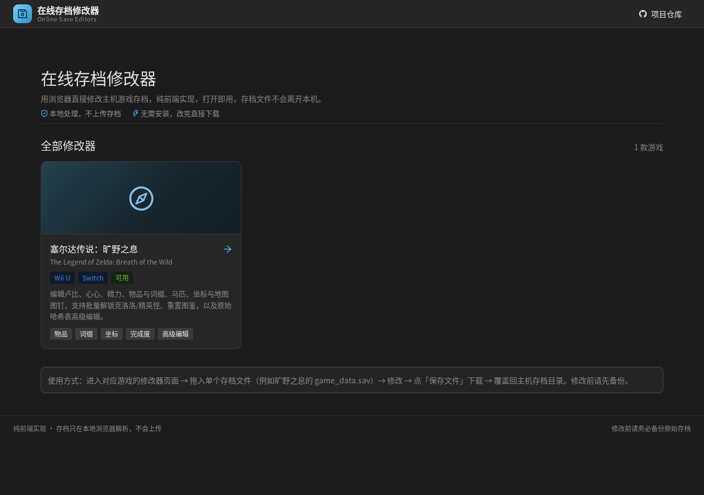
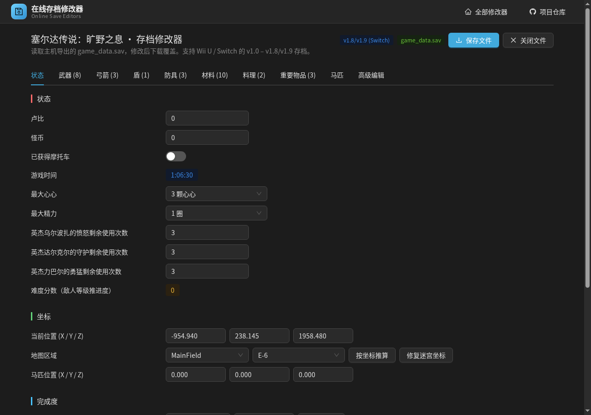

[English](README.en.md)

# 在线存档修改器（Game Save Editors）

一个纯前端的**在线游戏存档修改器集合**：用浏览器直接打开就能修改主机游戏存档，不需要安装程序，存档文件也不会离开本机。目前收录 1 款游戏，后续按同一套框架继续扩充。

- 仓库：https://github.com/matcha-cult/game-editors
- 已收录：《塞尔达传说：旷野之息》（Wii U / Switch，v1.0 – v1.8/v1.9）
- 路由：**Hash 模式**，地址形如 `/#/zelda-botw`，静态托管无需配置 rewrite

## 技术栈

| 层 | 选型 |
| --- | --- |
| 构建 | Vite 8 |
| 视图 | React 19 + TypeScript |
| 路由 | React Router 7（`HashRouter`） |
| 组件库 | Ant Design 6.6（暗色主题、中文 locale） |
| 存档读写 | 自实现 `DataView` 二进制层，无第三方依赖 |

## 路由

| 地址 | 页面 |
| --- | --- |
| `/#/` | 修改器集合首页（游戏卡片列表） |
| `/#/zelda-botw` | 塞尔达传说：旷野之息存档修改器 |
| 其它 `/#/...` | 404「没有这个修改器」，可一键返回首页 |

Hash 路由的好处：部署到 GitHub Pages、对象存储或任意子路径时都不需要服务端 rewrite，直接打开 `index.html` 也能正常跳转。

## 已收录的修改器

| 游戏 | 平台 | 主要功能 |
| --- | --- | --- |
| 塞尔达传说：旷野之息 | Wii U / Switch | 卢比、心心、精力、物品与词缀、马匹、坐标、地图图钉、克洛洛/精英怪批量解锁、图鉴重置、原始哈希表高级编辑 |

> 新增游戏：在 `src/games/<id>/` 下实现页面组件，然后往 `src/games/registry.tsx` 的 `GAMES` 数组里加一项，首页卡片与路由会自动生成。

## 界面截图

| 修改器集合首页 | 旷野之息修改器 |
| --- | --- |
|  |  |

## 快速开始

```bash
npm install          # 安装依赖
npm run dev          # 开发模式，默认 http://localhost:5173
npm run build        # 生产构建，输出到 dist/
npm run preview      # 本地预览构建结果
```

部署：把 `dist/` 目录放到任意静态托管（GitHub Pages、Nginx 等）即可；`vite.config.ts` 已设置 `base: './'`，可放在子路径下运行，Hash 路由不需要额外配置。

## 使用说明

1. 从主机导出存档：Switch（Atmosphere CFW）在 `sd:/atmosphere/titles/01007EF00011E000/save/` 下，Wii U 在 `mlc01/usr/save/00050000/101C9400/user/<用户ID>/` 下；`0/`–`5/` 是六个存档槽，每个槽里有一个 `game_data.sav`。
2. 在首页点开对应游戏，把**单个**存档文件拖进拖放区（不要拖整个 `save_0` 目录）。
3. 修改后点右上角 **保存文件**，浏览器会下载新存档，把它覆盖回主机存档目录。
4. 回到游戏里保存一次并正常退出，避免主机端缓存覆盖修改结果。

> 修改前请务必备份原始存档。

## 兼容版本（旷野之息）

版本表覆盖：v1.0 / v1.1 / v1.2 / v1.3 / v1.3.1 / Kiosk / v1.3.3 / v1.3.4 / v1.4 / v1.5 / v1.5\* / v1.6 / v1.6\* / v1.6\*\* / v1.6\*\*\* / v1.8·v1.9，同时兼容被 mod 修改过、文件大小在 896976–1500000 字节之间的存档。

## 目录结构

```
game-editors/
├── index.html                  # Vite 入口
├── package.json
├── vite.config.ts
├── docs/                       # 界面截图
├── public/
│   └── assets/                 # 图标图集、示例存档、哈希表（45052 条）
└── src/
    ├── main.tsx                # 入口：ConfigProvider + 中文 locale + HashRouter
    ├── App.tsx                 # 路由表（首页 / 各游戏 / 404）
    ├── theme.ts                # Ant Design 主题 token
    ├── index.css               # 站点与页面样式
    ├── layout/
    │   └── AppLayout.tsx       # 站点外壳：顶部导航 + 页脚
    ├── pages/
    │   ├── HomePage.tsx        # 修改器集合首页
    │   └── NotFoundPage.tsx    # 404
    ├── games/
    │   ├── registry.tsx        # 游戏清单：路由、名称、平台、缩略图、页面组件
    │   └── zelda-botw/
    │       ├── ZeldaBotwPage.tsx  # 游戏页（工具栏 + 页签）
    │       ├── core/           # 二进制读写、版本表、存档逻辑、高级编辑、图标、难度分数
    │       ├── data/           # 物品译名（1012 条）、地点坐标（1171 个）
    │       ├── state/          # 载入 / 修改 / 下载存档的 React 状态
    │       └── components/     # 拖放区、状态页、物品页、马匹页、高级编辑、图标
```

## 数据说明

- 物品译名、词缀、染色、马匹类型、克洛洛与敌人哈希等常量，由既有编辑器数据机械转换而来，未手工改动数值。
- 图标来自 23 张 16 列 × 64px 图集，按 `background-position` 裁切；防具按染色号取同一行的染色版本。
- 哈希表（`public/assets/zelda-botw.hashes.csv`）在打开「高级编辑」时按需加载，不进入首屏包体。

## 免责声明

- 本工具仅用于个人存档修改，请自行备份存档；因使用本工具造成的存档损坏、进度丢失等后果由使用者自行承担。
- 请勿将本工具用于商业用途或在线对战场景。
